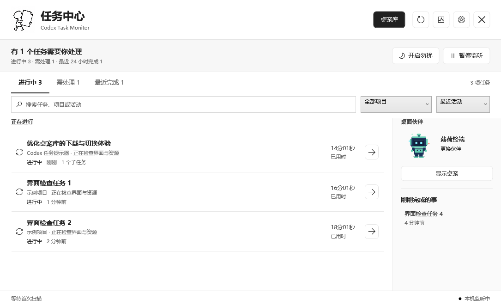
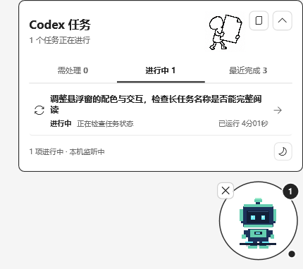

# Codex Task Monitor

[简体中文](README.md) | [English User Guide](docs/USER_GUIDE.en.md) | [Custom Pets](docs/CUSTOM_PETS.md) | [Releases](https://github.com/sbsndbdhdhssbsbdbbdbdndbddbdbb-debug/codex-task-monitor-desktop/releases)

When several Codex chats are working in the background, keep a separate window nearby to see what is running, what needs a response, and what just finished. Codex Task Monitor is a Windows x64 WPF desktop tool with a task center, completion notifications, and a floating pet or orb, with a route back to each chat.

**Preview `v0.1.0-beta.1`, not a stable release.** See the [Release list](https://github.com/sbsndbdhdhssbsbdbbdbdndbddbdbb-debug/codex-task-monitor-desktop/releases) for version notes and available assets.

## Why I Built It

When I created this project, I wanted a separate, glanceable window for my multi-chat workflow. Codex has its own companion too; this describes the author's needs at project creation, not a claim about missing features in Codex today. This is an independent, unofficial tool.

Tasks still run in Codex. The monitor shows status, sends notifications, and attempts navigation; it does not execute, reply to, or stop tasks for you.

## What It Shows

| Group | What To Look For |
| --- | --- |
| In progress / 进行中 | Session events indicating processing, reasoning, tool calls, or output |
| Needs attention / 需处理 | Detected input waits or failures |
| Recently completed / 最近完成 | Completion events detected within the last 24 hours |

Search tasks, projects, or activity, filter by project, and sort by latest activity or elapsed time. Select a task to inspect activity, timestamps, directory, and detected children. Double-click, press Enter, or use its open button to attempt navigation.



## Keep It Nearby

Click the pet to expand its task list, then click a task to attempt opening its chat. Collapse it into an orb and click to restore it. Drag either between monitors, or recall the pet from the main window's Show pet action or the tray.

Turn on Do Not Disturb for quiet work while status updates continue. Monitoring pause only suspends automatic reads, not Codex tasks. Configure topmost display, animation, and notifications in settings.



Local-record detection can lag or be incorrect. Elapsed time is not a completion percentage, and completion is not result acceptance. Chat navigation depends on the local Codex protocol handler and may fail to locate a chat; verify in Codex.

## Download And Run

1. Check the [Release list](https://github.com/sbsndbdhdhssbsbdbbdbdndbddbdbb-debug/codex-task-monitor-desktop/releases) for `v0.1.0-beta.1` notes and available assets, and choose `CodexTaskMonitor-win-x64.zip`.
2. Extract the entire ZIP into a folder you can write to. Do not run it inside the archive.
3. Launch the extracted `CodexTaskMonitor.exe` and use Codex normally to start your tasks.

This is an extraction-based package, not an installer, configured to include the .NET 8 runtime. No separate .NET Desktop Runtime, SDK, or PowerShell 7 is needed to run it. Retain the included documentation, `docs` manuals, and license material such as `licenses`.

See [Security](SECURITY.md) for the runtime support deadline and migration requirements. This preview does not promise long-term support.

The executable is unsigned, so Windows may show a security warning. Verify its source and release information, keep system protections enabled, and stop if trust cannot be established.

See the [English User Guide](docs/USER_GUIDE.en.md) for daily use, settings, troubleshooting, and removal. The current app UI is primarily Chinese.

## Petdex And Custom Pets

Open **桌宠库** (Pet library) to preview, search, download, and apply characters in **发现桌宠** (Discover). Switch existing companions or delete downloaded packages in **我的桌宠** (My pets).

You can also paste a Petdex slug, `https://petdex.dev/pets/<slug>`, or `npx petdex install <slug>` text. The app extracts the identifier; **it does not execute the command**, and Node.js/npx is not required.

There is **no one-click import of arbitrary folders, ZIPs, or single images**. Custom pets need manually prepared `petdex-package.json`, `pet.json`, and `spritesheet.png`. The online adapter assumes 8 columns x 9 rows; not every format is supported. See [Custom Pets](docs/CUSTOM_PETS.md) for the full contract.

[Petdex](https://petdex.dev/) artwork retains its own permissions. Check sources and licenses and retain author attribution; this project's MIT license does not cover third-party characters or images.

## Data And Privacy

- Reads local sessions under `%USERPROFILE%\.codex`. Settings, databases, and logs in `%LOCALAPPDATA%\CodexTaskMonitor` may contain titles, paths, and activity. No task-upload logic was found in the current monitoring code.
- Petdex browsing, previews, and downloads make network requests; contacted services normally see IP addresses and requests. See the guide for pet storage locations; avoiding the system drive is not promised.
- Privacy mode only masks selected output. **It does not anonymize the database, main window, floating list, or screenshots.** The default-enabled local API binds only to `127.0.0.1`, with bearer tokens for task/event endpoints.

See the [User Guide](docs/USER_GUIDE.en.md) and [Security](SECURITY.md) for exact masking behavior, the local API, and safe cleanup.

## Build From Source

Use Windows, **PowerShell 7 (`pwsh`)**, and the latest supported .NET 8 SDK. This preview's build baseline is SDK `8.0.427` / runtime `8.0.33`. Run from the checkout root:

```powershell
dotnet restore CodexTaskMonitor.sln
dotnet test CodexTaskMonitor.sln
pwsh -NoProfile -File ./scripts/publish.ps1
```

The default output is `artifacts/publish/win-x64`; **the output directory must be empty**. Use `-OutputDirectory '<empty-output-folder>'` for a new directory if it already contains files. The script also copies manuals and exports license material. Exit the monitor through the tray before republishing, and do not delete personal data to empty an output directory.

Public test screenshots use synthetic tasks, placeholder paths, and the original built-in mint pet (薄荷终端). Do not submit personally downloaded pets, real chats, databases, logs, or tokens. See the contribution guidance below.

## License And Participation

Project code uses the MIT license; see [LICENSE](LICENSE). Third-party dependencies and artwork retain their respective licenses.

[Third-party notices](THIRD_PARTY_NOTICES.md) | [Security policy](SECURITY.md) | [Contributing](CONTRIBUTING.md) | [Code of conduct](CODE_OF_CONDUCT.md)
