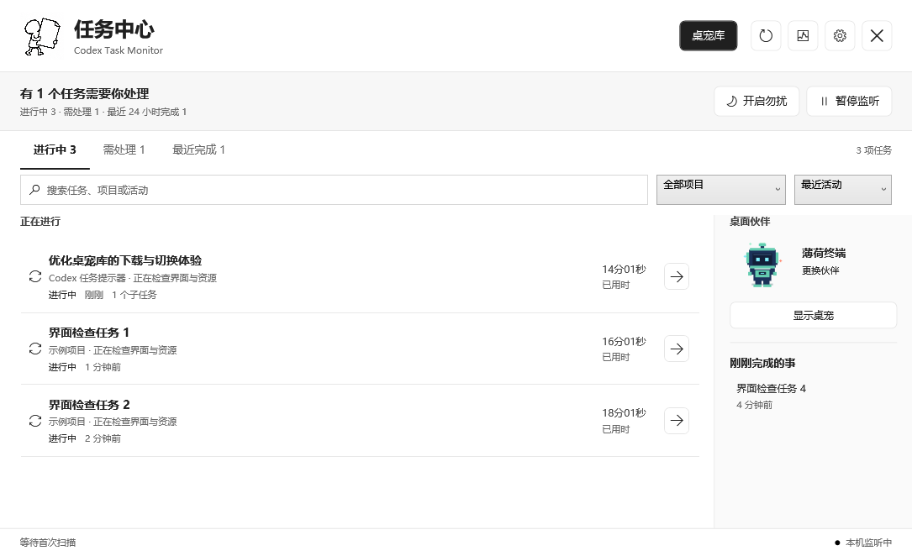
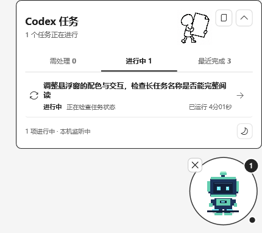

# Codex Task Monitor

[English](README.en.md) | [中文使用手册](docs/USER_GUIDE.zh-CN.md) | [自制桌宠](docs/CUSTOM_PETS.md) | [Releases](https://github.com/sbsndbdhdhssbsbdbbdbdndbddbdbb-debug/codex-task-monitor-desktop/releases)

同时让几个 Codex 聊天在后台工作时，用一个独立窗口看看：哪些还在进行，哪些需要回应，哪些刚刚完成。Codex Task Monitor 是面向 Windows x64 的 WPF 桌面工具，提供任务中心、完成提醒、悬浮桌宠与小圆球，让你从列表点回对应聊天。

**预览版 `v0.1.0-beta.1`，非稳定版。** 版本说明及可用附件见 [Release 列表](https://github.com/sbsndbdhdhssbsbdbbdbdndbddbdbb-debug/codex-task-monitor-desktop/releases)。

## 为什么做它

创建这个项目时，我想为自己的多聊天工作流留一个随手可看的独立窗口。Codex 本身也有自己的桌面伙伴；这里记录的是作者当时的需求，不是对 Codex 当前功能的缺失声明。本项目是独立、非官方工具。

任务仍在 Codex 中执行；监视器负责查看状态、提醒和尝试跳转，不会替你执行、回复或停止任务。

## 能看到什么

| 分组 | 看什么 |
| --- | --- |
| 进行中 / In progress | 根据会话事件判断正在处理、思考、调用工具或生成内容的任务 |
| 需处理 / Needs attention | 检测到等待输入或失败的任务 |
| 最近完成 / Recently completed | 最近 24 小时内检测到完成事件的任务 |

主窗口支持搜索任务、项目或活动，按项目筛选，按最近活动或运行时长排序。单击任务查看活动、时间、目录和识别到的子任务；双击、按 Enter 或点打开按钮尝试回到聊天。



## 放在桌面一角

点桌宠展开任务列表，直接点任务尝试打开聊天；收纳为小圆球后，点击即可恢复。桌宠和圆球可跨显示器拖动，也能从主窗口“显示桌宠”或托盘召回。

需要安静时开启勿扰，状态仍继续更新；暂停监听只暂停监视器自动读取，不会暂停 Codex。置顶、动画和提醒方式都可在设置中调整。



状态来自本地记录，可能延迟或误判；已用时不是完成百分比，“完成”不等于成果验收。聊天跳转依赖本机 Codex 协议处理，可能无法定位，请以 Codex 中的实际情况为准。

## 下载与启动

1. 在 [Release 列表](https://github.com/sbsndbdhdhssbsbdbbdbdndbddbdbb-debug/codex-task-monitor-desktop/releases)查看 `v0.1.0-beta.1` 的说明和可用附件，选择 `CodexTaskMonitor-win-x64.zip`。
2. 将整个 ZIP 解压到自己有写入权限的文件夹，不要直接在压缩包里运行。
3. 启动解压后的 `CodexTaskMonitor.exe`，同时在 Codex 中正常开展任务。

这是解压运行包，不是安装向导，已配置为包含 .NET 8 运行时，无需另装 .NET Desktop Runtime、SDK 或 PowerShell 7。请完整保留包内的说明、`docs` 手册和 `licenses` 等许可文件。

运行时支持期限与后续迁移要求见[安全说明](SECURITY.md)；本预览版不承诺长期支持。

程序未签名，Windows 可能显示安全警告。请核对来源和发布信息，保留系统安全保护；无法确认可信时停止运行。

日常流程、设置、排查与卸载见[中文使用手册](docs/USER_GUIDE.zh-CN.md)。当前应用界面主要为中文。

## Petdex 与自制桌宠

打开“桌宠库”，在“发现桌宠”中预览、搜索、下载并应用角色；在“我的桌宠”切换已有角色或删除下载包。

也可粘贴 Petdex slug、`https://petdex.dev/pets/<slug>` 或 `npx petdex install <slug>` 文本。程序只解析角色标识，**不会执行命令**，无需 Node.js 或 npx。

目前**没有任意文件夹、ZIP 或单张图片的一键导入**。自制桌宠需手工准备 `petdex-package.json`、`pet.json` 和 `spritesheet.png`；在线适配按 8 列 x 9 行处理，不保证兼容所有格式。完整约定见[自制桌宠说明](docs/CUSTOM_PETS.md)。

[Petdex](https://petdex.dev/) 素材仍按各自授权使用，请核对来源与许可证、保留作者署名；本项目的 MIT 许可不覆盖第三方角色和图像。

## 数据与隐私

- 读取 `%USERPROFILE%\.codex` 中的本机会话；设置、数据库与日志保存在 `%LOCALAPPDATA%\CodexTaskMonitor`，可能含标题、路径和活动信息。当前监控代码中未发现任务上传逻辑。
- Petdex 浏览、预览和下载会联网，服务方通常可见 IP 和请求信息。桌宠存储位置见手册，不能承诺不使用系统盘。
- 隐私模式只遮盖部分输出，**不会匿名化数据库、主窗口、悬浮列表或截图**。默认启用的本机 API 仅监听 `127.0.0.1`，任务/事件接口使用 bearer token。

具体的遮盖范围、本机 API 和安全清理步骤见[使用手册](docs/USER_GUIDE.zh-CN.md)与[安全说明](SECURITY.md)。

## 从源码构建

需要 Windows、**PowerShell 7（`pwsh`）**和受支持的最新 .NET 8 SDK。本预览版的构建基线为 SDK `8.0.427` / 运行时 `8.0.33`。从仓库根目录运行：

```powershell
dotnet restore CodexTaskMonitor.sln
dotnet test CodexTaskMonitor.sln
pwsh -NoProfile -File ./scripts/publish.ps1
```

默认输出为 `artifacts/publish/win-x64`，**输出目录必须为空**。已有输出时使用 `-OutputDirectory '<empty-output-folder>'` 指定新目录；脚本同时复制手册并导出许可材料。重新发布前先从托盘退出监视器，不要为了清空目录删除个人数据。

公开测试截图使用合成任务、占位路径和原创内置“薄荷终端”（`mint`）。请勿提交个人下载桌宠、真实聊天、数据库、日志或令牌；贡献约定见下方文档。

## 许可证与参与

项目代码采用 MIT 许可，见 [LICENSE](LICENSE)。第三方依赖与素材分别遵循各自许可。

[第三方说明](THIRD_PARTY_NOTICES.md) | [安全政策](SECURITY.md) | [贡献指南](CONTRIBUTING.md) | [行为准则](CODE_OF_CONDUCT.md)
